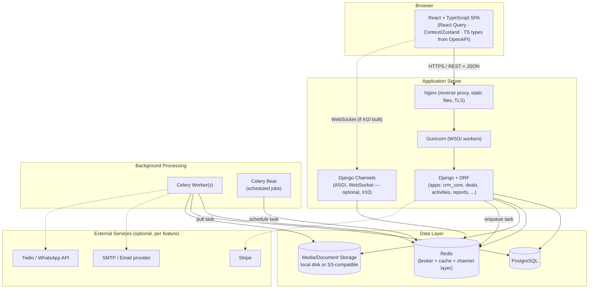

# CRM Project — Django/DRF + React/TypeScript Roadmap

**Follows:** [ROADMAP.md](ROADMAP.md) (6-month Python/Django/DRF core track). Start this after that roadmap's Month 6 capstone, or use this project itself as the Month 6 capstone if you want to skip the generic "orders" capstone and build the real product instead.

**Audience:** 5 yrs software industry experience, ERP/data-heavy background, comfortable with React, new to TypeScript.
**Goal:** Ship a single-tenant CRM API + admin dashboard, sellable on CodeCanyon, portfolio-grade.
**Stack:** Django + DRF (backend), PostgreSQL (database), React + TypeScript (frontend). Locked in — no Laravel/PHP alternative under consideration.
**Frontend note:** Since you already know React, frontend weeks skip JSX/component basics and focus on TypeScript typing patterns (generics, discriminated unions, API typing, form/state typing) applied to real React code.
**Database note:** Postgres-specific features are used deliberately, not just "any SQL DB" — `JSONField` (custom fields, #8), full-text `SearchVector`/`SearchRank` (search, #13), trigram similarity via `pg_trgm` (duplicate detection, #5), and `ArrayField` where useful (tags). Don't swap to MySQL/SQLite for production — some of these features either don't exist or work differently there.
**Scope decision:** Single-tenant (one install per customer/license) — no tenant isolation layer, no schema-per-tenant complexity. Simpler auth, simpler queries, matches standard CodeCanyon licensing (one license = one deployment).
**Package philosophy:** Prefer Python/Django/JS stdlib and built-ins over external packages. Only pull in a dependency when the stdlib genuinely can't do the job safely or reasonably (crypto, PDF rendering, image/office file parsing) — not for convenience alone. See the Stack & Packages section below for what's actually required vs skippable.

---

## Stack & Packages — What's Actually Required

Beyond the core four (Django, DRF, PostgreSQL, React+TypeScript), here's everything else the full feature set (below) needs to run — split into **infrastructure** (services you must run) and **packages** (marked Required vs Avoidable). Default to stdlib/Django built-ins; only add a package when the Required column says so.

### Infrastructure (not Python packages — services/processes)
| Piece | Needed for | Can you skip it? |
|---|---|---|
| **Redis** | Celery broker/result backend, cache backend, Django Channels layer | No reasonable substitute if you build Automation (#4), Reminders (A3), or real-time Notifications (#10). Postgres-as-broker (`django-db-queue` style) is possible but more work than it saves. |
| **Celery worker + beat** | All scheduled/background jobs (reminders, sequences, webhook retries) | No — `threading`/stdlib alone can't survive process restarts or scale workers. This is the one place "avoid packages" doesn't apply; Celery *is* the standard tool here. |
| **Nginx/Gunicorn or uWSGI** | Serving Django in production | Standard deployment need, not optional, but not a "package" concern for your codebase. |
| **S3-compatible object storage** (or local disk for CodeCanyon self-host buyers) | Document storage (#18), attachments | Local `MEDIA_ROOT` disk storage works fine for a self-hosted CodeCanyon script — skip S3/`django-storages` unless you offer a hosted SaaS version. |

### Packages by feature — Required vs Avoidable

| Feature | Required package | Why stdlib/Django isn't enough | Avoidable? |
|---|---|---|---|
| Async task queue | `celery` | No stdlib equivalent for durable, retryable, scheduled background jobs | Required |
| JWT auth | `djangorestframework-simplejwt` | DRF has no built-in JWT; hand-rolling JWT signing/verification is a security risk not worth taking | Required |
| API filtering | `django-filter` | DRF's own filtering is minimal; writing every filter by hand doesn't scale past ~2 endpoints | **Avoidable** — hand-write filters via `Q()` objects for a small endpoint count; add the package only once you have many filterable list views |
| API docs (Swagger) | `drf-spectacular` | No stdlib OpenAPI generator; buyers expect Swagger UI | Required (CodeCanyon buyers expect this) |
| Test data factories | `factory_boy` | Django fixtures (JSON) are fine too | **Avoidable** — plain Django `TestCase` fixtures or simple factory functions work; add the package only if factories get complex/reused heavily |
| Env config | `django-environ` | `os.environ.get()` + a `.env` parsed by `python-dotenv`-style stdlib pattern works | **Avoidable** — a 10-line hand-rolled `.env` loader using stdlib `os`/`pathlib` is genuinely enough; skip the package |
| PDF generation (#6 quotes/invoices, #11 per-module print/export) | `weasyprint` or `reportlab` | No stdlib PDF writer at all | Required (pick one, not both) — one shared renderer, reused by every module's export action, not just Quotes/Invoices |
| Excel import/export (#11, per-module) | `openpyxl` | No stdlib `.xlsx` reader/writer (stdlib `csv` covers CSV only) | Required — committed for v1 across every module's export action (not CSV-only); still pick `openpyxl` over `pandas` here since you only need read/write, not analysis, and it's the lighter dependency |
| Fuzzy dedup matching (#5) | none needed | Postgres `pg_trgm` extension (SQL-level, not a Python package) does trigram similarity natively | **Avoidable** — skip `rapidfuzz`, use Postgres trigram via a raw `SearchVector`/`TrigramSimilarity` query instead |
| Full-text search (#13) | none needed | Postgres built-in `SearchVector`/`SearchRank`, exposed via `django.contrib.postgres.search` | **Avoidable** — this is a Django built-in, not an external package at all |
| Real-time notifications (#10) | `channels` + `channels-redis` | No stdlib WebSocket/ASGI consumer framework | Required *only if* doing true real-time; **avoidable** by polling a normal DRF endpoint every N seconds instead — much simpler, "avoid packages" wins here for v1 |
| SSO (#23) | `django-allauth` or `python3-saml` | SAML/OAuth2 protocol correctness is not something to hand-roll (security-critical) | Required *only if* building SSO at all — treat as a later/optional feature, skip entirely for v1 |
| 2FA (#23) | `pyotp` | TOTP algorithm (RFC 6238) is small but easy to get subtly wrong — worth the tiny dependency | Required if doing 2FA; otherwise skip |
| Object-level audit history (#12) | `django-simple-history` | Hand-rolling generic history tracking across many models is real work | **Avoidable** — hand-roll a single `AuditLogEntry` model + `pre_save` diffing for just the fields you care about (per roadmap's existing plan); skip the package unless the model count grows large |
| Advanced role/permission management (#24) | none needed | Django's built-in `auth.Group`/`Permission` + a hand-rolled `ObjectPermission` table (`user`, `content_type`, `object_id`, `permission`) covers role-based + object-level + scoped access without a dependency | **Avoidable** — skip `django-guardian`/`rules`; a hand-rolled model gives you full control over the scope enum (`own`/`team`/`territory`/`all`) and field-level checks this roadmap needs, which `django-guardian` doesn't model out of the box anyway |
| E-signature (#18) | none (build minimal) or DocuSign/HelloSign SDK | A minimal "draw/type signature + timestamp + hash" flow can be entirely hand-built with stdlib `hashlib` for integrity | **Avoidable** — build a basic self-signed flow first; only add a signing-provider SDK if buyers specifically need legal-grade e-signature compliance |
| Telephony (#16) | `twilio` (or vendor SDK) | Voice/SMS requires a telephony provider; no way around a vendor SDK/API | Required *only if* building #16 at all |
| Email sending | none needed | Django's built-in `django.core.mail` (with any SMTP backend) covers outbound email entirely | **Avoidable** — no package needed for basic send; only reach for `anymail` if you want multi-provider (SES/SendGrid/Postmark) abstraction later |
| HTTP client (webhooks, external APIs) | none required | stdlib `urllib.request` works but is painful; `httpx` is the pragmatic choice your core roadmap already teaches (Month 3 Project 3) | **Borderline** — keep `httpx` since it's already part of your core Python learning, not a CRM-specific add |

### Frontend (React/TypeScript) — same philosophy
| Need | Required package | Avoidable? |
|---|---|---|
| Data fetching/caching | `@tanstack/react-query` | **Not really avoidable** — hand-rolled fetch+state loses caching/retry/dedup that's central to B2's teaching goal; this is the one frontend package worth keeping |
| Forms | `react-hook-form` + `zod` | **Avoidable for simple forms** — plain controlled components + manual validation work fine for 1-2 field forms; add the pair once forms get complex (nested, multi-step) |
| Drag-and-drop pipeline board (#B4) | `@dnd-kit/core` | **Avoidable only with real effort** — native HTML5 drag events work but are notoriously fiddly; a small package is the pragmatic call here |
| Charts (#B5 dashboard) | a lightweight chart lib (e.g. `recharts`) | **Avoidable** — inline SVG for simple bar/line charts is very doable (see the `dataviz` skill's approach) and keeps the bundle smaller; add a chart library only once you need many chart types |
| Styling | none required | Plain CSS/CSS Modules avoid Tailwind/styled-components entirely if you want zero styling dependencies | **Avoidable** — genuinely optional |

### Bottom line
Truly non-negotiable additions: **Celery + Redis**, **simplejwt**, **drf-spectacular**, one **PDF library** (shared across Quotes #6 and per-module print/export #11), **openpyxl** (per-module Excel export #11), **React Query**. Everything else in the full feature list has a stdlib/Django-built-in/hand-rolled path — the table above tells you which.

---

## Architecture Plan

Sized for where this actually starts (single-tenant, self-hosted CodeCanyon script) and where it's headed (ERP-scale, per the Full Feature Set and the earlier growth-trigger note on state management). Nothing here requires microservices or Kubernetes — a modular monolith is the right call at this size, and splitting services prematurely would cost more than it saves.

### 1. High-level component diagram



**Why this shape:** Django/DRF stays a single deployable unit (a "modular monolith") — internally split into bounded-context apps (see #2 below), but one codebase, one deploy pipeline. Celery workers are the only separately-scaled process, because background job load (email sends, webhook retries, reminders) doesn't scale 1:1 with web request load. This matches what a solo/small-team CodeCanyon build can actually operate — a microservice split adds deployment complexity with no corresponding benefit until you have separate teams or wildly different scaling needs per component, neither of which applies here.

### 2. Module boundaries (Django apps as bounded contexts)

Each app from the Full Feature Set section owns its own models and exposes a small service-layer API to other apps — apps don't reach into each other's models directly for writes (reads via FK/`select_related` are fine; **mutations go through the owning app's service function**, e.g. `deals.services.move_stage()`, not `Deal.objects.filter(...).update(...)` from another app). This is the same "explicit service method over signals" principle already used in A2, applied consistently as the app count grows toward ERP-scale.

```
crm_core      → Contact, Company, Tag, CustomField (the shared "who/what" the rest of the system references)
deals         → Deal, PipelineStage, DealStageHistory
activities    → Activity, Task
reports       → read-only aggregation views (depends on: deals, activities, crm_core — never depended on by them)
leads         → Lead, LeadScore, assignment rules (depends on: crm_core, deals — converts Lead → Contact/Deal)
automation    → Rule, Trigger, Sequence (depends on: activities, deals — reacts to their events)
billing       → Product, Quote, Invoice (depends on: crm_core, deals)
teams         → Territory, Team, Quota (depends on: auth/users, deals)
integrations  → Webhook, APIKey, delivery log (depends on: nothing domain-specific — generic dispatcher)
documents     → Attachment, Signature (depends on: crm_core, generic FK to attach anywhere)
audit         → AuditLogEntry (depends on: nothing — generic diff-and-record, hooked via pre_save on watched models)
access_control → Role, Permission, ObjectPermission, FieldPermission (depends on: auth/users only — every other app depends on *this*, not the other way around)
data_tools    → shared `exporters` (PDF/Excel/CSV) + import pipeline (depends on: nothing domain-specific — a generic queryset-in, file-out utility every app's ViewSet mixes in)
```

**Dependency rule:** arrows point one way — `reports`, `automation`, `integrations`, and `audit` are consumers/observers of the core domain apps (`crm_core`, `deals`, `activities`), never the other way around. This keeps the core domain apps testable in isolation and is what actually prevents the "ERP big ball of mud" failure mode as app count grows past 10+. `access_control` is the one exception to "consumers depend on core apps" — it sits *underneath* everything (every domain app's querysets/serializers call into it), so it must have zero dependencies on domain apps to avoid a circular import.

### 3. Request flow (typical read + write)

- **Read** (e.g. load pipeline board): `React Query` → DRF `ViewSet.list()` → `select_related`/`prefetch_related` queryset (N+1-safe, per A2/A4) → serialized JSON → cached client-side by React Query's own cache, not a custom cache layer.
- **Write** (e.g. move a deal's stage): `React Query` mutation → DRF `ViewSet.partial_update()` → calls `deals.services.move_stage()` (wrapped in `atomic()` + `select_for_update()`, per A2) → on success, Django signals *within* the same app only (e.g. `DealStageHistory` row) → any *cross-app* reaction (e.g. automation rule "notify manager") happens via an explicit event the `automation` app subscribes to, not an implicit signal reaching across app boundaries.
- **Background** (e.g. reminder email): `Celery Beat` fires on schedule → task queries due reminders → `Celery Worker` sends via `django.core.mail` → result logged, retried with backoff on failure (reuses Month 3 retry pattern).

### 4. Deployment topology (progressive, not big-bang) — Docker throughout

Docker is the deployment mechanism at every stage, not just a dev convenience — every environment (local, buyer self-host, hosted SaaS) runs the same images, which is exactly what makes a CodeCanyon script installable by a buyer who isn't a DevOps engineer.

**Containers (services), each with its own `Dockerfile` where it needs one:**
```
web         → Django + Gunicorn (built from the same image as worker/beat — same codebase, different CMD)
worker      → Celery worker (same image as web, CMD overridden to `celery -A crm worker`)
beat        → Celery beat (same image, CMD overridden to `celery -A crm beat`)
frontend    → React/TS build stage (multi-stage Dockerfile: node build → static files) — served by nginx in prod, or the Vite dev server in dev
nginx       → reverse proxy + static file serving + TLS termination
postgres    → official `postgres` image, named volume for data persistence
redis       → official `redis` image (broker + cache + channel layer)
```

Using **one image for `web`/`worker`/`beat`** (same `Dockerfile`, different container `command:`) avoids maintaining three near-duplicate images and guarantees worker code never drifts from web code — a real bug source if you build these separately.

| Stage | Topology | When |
|---|---|---|
| **Local dev** | `docker-compose.yml`: all 7 services above, bind-mounted source for hot-reload, `docker compose up` as the only setup step | From day one of A1 — no "install Postgres/Redis locally" instructions needed, ever |
| **CodeCanyon buyer self-host (v1 target)** | `docker-compose.prod.yml` on a single VPS: same containers, no bind mounts (built images instead), `.env` for secrets, buyer runs `docker compose up -d` per the install docs from Part C | Ship target for Part C — this **is** the install process you document, not a separate deployment guide |
| **Later, if hosted SaaS (per #23)** | Same images, orchestrated instead of `docker-compose` (e.g. a managed container platform), managed Postgres/Redis swapped in via env vars only — **no image rebuild needed**, just different `DATABASE_URL`/`REDIS_URL` | Only if you pivot from license-sale to hosted, per the earlier #23 decision to keep this last |

Don't design for the third row yet — building buyer-self-host-friendly (single-VPS, `docker compose up`-able, no exotic managed-service dependencies) is what actually matters for the CodeCanyon goal, and it's also strictly simpler to build than a distributed system, so there's no tension between "easy to build" and "matches the actual goal." Keeping dev/self-host/SaaS on identical images means the only thing that ever changes between them is environment variables and which compose file you run — never the code or the Dockerfiles themselves.

### 5. Where this scales as the feature list grows

The Full Feature Set's growth (23 items, ERP-scale ambition) is handled by **adding apps within the same monolith**, not by fragmenting into services. The two real scaling questions to watch for, matching the earlier state-management growth-trigger discussion:
- **Web tier:** Gunicorn worker count scales with request volume — a standard, well-understood axis, no architecture change needed until genuinely high traffic.
- **Async tier:** Celery worker count scales independently — if e.g. WhatsApp/email volume (#17/#2) grows much faster than web traffic, add worker processes/queues (`celery -Q emails,webhooks,reports` with per-queue concurrency) rather than restructuring anything. This is the actual mechanism for "the system gets bigger without a rewrite."

---

## Full Feature Set — What an Advanced CRM Actually Has

Part A/B below cover the core skeleton (contacts, deals, activities, reports). A CRM that competes on CodeCanyon or as a real SaaS needs more than that. Use this as the master checklist — build core first (A1–A6, B1–B6), then work down this list. Each item notes which new Django app/module it lives in and what it teaches beyond the core roadmap.

### 1. Sales & Pipeline (core — covered in A1/A2)
- Contacts, Companies, Deals, Pipeline stages, Activities, Tasks — done in Part A

### 2. Email Integration
- Inbound: connect a mailbox (IMAP) or webhook (SendGrid/Postmark/SES inbound parse) to auto-log emails against a contact/deal by matching sender address
- Outbound: send emails from the CRM (templates with merge fields — `{{contact.first_name}}`), tracked opens/clicks (tracking pixel + link rewriting)
- Email templates module with versioning
- **New app:** `emailing` — teaches: webhook handling, `httpx`/`aiosmtplib` for async send, HTML templating (Django templates or Jinja2 for email bodies), signed tracking-pixel URLs

### 3. Calendar & Scheduling
- Meeting scheduling tied to deals/contacts, calendar sync (Google Calendar API / CalDAV) — two-way sync is the hard, advanced part
- Availability/booking links (like Calendly) for external prospects to self-book
- **New app:** `scheduling` — teaches: OAuth2 flow (Google), timezone-correct datetime handling (`zoneinfo`), external API sync with conflict resolution

### 4. Sales Automation / Workflow Engine
- Trigger → condition → action rules (e.g. "deal stuck in stage 5 days → notify manager"), built as data (stored rules), not hardcoded signals
- Sequences/cadences: automated multi-step email/task sequences for lead nurture
- **New app:** `automation` — teaches: rule-engine design (this is the most "senior" module — evaluating stored conditions safely, avoiding `eval()`), Celery chaining/chords for multi-step sequences

### 5. Lead Management & Web-to-Lead
- Public API endpoint / embeddable form for capturing leads from a website, lead scoring (rule-based or weighted), lead assignment (round-robin or rule-based routing to reps)
- Duplicate detection/merge (fuzzy match on email/phone/name)
- **New app:** `leads` — teaches: public unauthenticated endpoints with rate-limiting + spam protection (honeypot/reCAPTCHA), assignment algorithms, fuzzy matching (`rapidfuzz` or trigram similarity in Postgres)

### 6. Quotes, Invoicing & Products
- Product/price-list catalog, quote builder (line items, discounts, tax), quote → invoice conversion, PDF generation
- Optional payment collection (Stripe) on invoices
- **New app:** `billing` — teaches: PDF generation (`weasyprint`/`reportlab`), decimal/currency handling correctness (never floats for money — direct callback to core roadmap's `Decimal` JSON serialization week), Stripe webhook handling

### 7. Territory & Team Management
- Sales territories (by region/industry/account size), team hierarchies, manager roll-up visibility (manager sees team's deals, not just their own)
- Goal/quota tracking per rep/team, forecast vs actual
- **New app:** `teams` — teaches: hierarchical permission trees (extends A5's object-level permissions), recursive/tree queries (`django-mptt` or recursive CTEs)

### 8. Custom Objects & Fields (platform-level feature)
- Let admin users define custom entities beyond Contact/Deal (e.g. "Properties" for a real-estate CRM buyer) without code changes — dynamic schema
- Custom field types (text/number/date/dropdown/lookup) attached to any entity
- **New app:** `custom_fields` — teaches: dynamic model patterns (JSONField-backed with a metadata schema table, or `django-eav2`-style), this is the single feature that makes a CRM "platform-grade" instead of "one vertical only" — high CodeCanyon value

### 9. Integrations & Webhooks (outbound)
- Outbound webhooks (notify external systems on deal-won, contact-created, etc.) with signed payloads and retry/backoff
- API key management UI (issue/revoke keys, scoped permissions per key)
- Zapier-style "connect your CRM to anything" is often the #1 requested feature by CodeCanyon buyers
- **New app:** `integrations` — teaches: HMAC payload signing, webhook delivery retry queues (reuses Month 3 retry/backoff pattern), scoped API-key auth (distinct from user JWT auth)

### 10. Notifications
- In-app notifications (bell icon, real-time via WebSockets/Django Channels or polling), email digest notifications
- **New app:** `notifications` — teaches: Django Channels (async, WebSocket consumers) — a natural extension of the core roadmap's asyncio month applied to Django specifically

### 11. Import/Export & Data Tools
- CSV/Excel bulk import with column mapping UI + validation report (not just "upload and pray")
- Bulk export, scheduled exports
- **Per-module print/export (PDF + Excel):** every module with a list/detail view (Contacts, Companies, Deals, Activities, Reports, Billing, Teams, …) gets consistent "Export PDF" and "Export Excel" actions on both list views (the current filtered/sorted queryset) and single-record detail views (a formatted one-record document) — not a one-off built per app, but one shared `exporters` utility (`export.to_pdf(queryset, template)`, `export.to_xlsx(queryset, column_map)`) that every `ViewSet` reuses via a mixin, so each new app gets both formats for free instead of reimplementing rendering
- **New app:** `data_tools` — teaches: streaming large-file processing (ties back to core roadmap's Project 1 lazy-pipeline pattern, applied to CRM data), `openpyxl` for Excel read/write (bulk import *and* per-module export), `weasyprint`/`reportlab` for PDF (reused from #6's Quotes/Invoices renderer, generalized to any queryset/template), idempotent import (re-running an import shouldn't duplicate records)

### 12. Audit Log & Compliance
- Full audit trail (who changed what field, when, old→new value) across all entities — not just deals
- GDPR tools: data export per contact, right-to-be-forgotten (anonymize, not just delete, to preserve deal history integrity)
- **New app:** `audit` — teaches: generic change-tracking (`django-simple-history` or hand-rolled via `post_save`/`pre_save` diffing — good place to *contrast* with the roadmap's "avoid signals" guidance and decide audit logging is the justified exception), anonymization strategies

### 13. Search
- Full-text search across contacts/deals/notes (Postgres full-text search or a dedicated search index)
- Advanced filter builder (AND/OR groups, saved filters/views)
- **New app:** `search` — teaches: Postgres `SearchVector`/`SearchRank`, or wiring in a proper vector index if you later want it; complex filter-tree query building with `Q()` objects composed dynamically

### 14. Multi-currency & Localization
- Multiple currencies with exchange rate handling, i18n (multiple languages) for a CodeCanyon buyer base that's often non-English
- **Cross-cutting**, not a new app — touches `billing` and Django's `django-modeltranslation`/`gettext`

### 15. Mobile-friendly API considerations
- Push notification support (FCM), offline-friendly sync endpoints (delta sync via `updated_at` cursors) if a buyer wants to build a mobile app against your API later
- **Cross-cutting API design concern**, not a full app — documented as an API design principle in A5

### 16. Telephony / Call Center (Click-to-Call)
- Click-to-call via Twilio/Vonage, call recording links attached to Activity, IVR/call routing basics, call disposition logging
- **New app:** `telephony` — teaches: third-party voice API webhooks (call-status callbacks), signed webhook verification, storing external media URLs (recordings) not the files themselves

### 17. WhatsApp / SMS / Social Messaging
- WhatsApp Business API / SMS (Twilio) as another activity channel — huge for CodeCanyon buyers outside the US/EU where WhatsApp is the primary sales channel
- Two-way conversation thread per contact (inbound webhook + outbound send), same pattern as Email Integration (#2) but a different channel
- **New app:** extend `emailing` into a generic `messaging` app — teaches: channel-abstraction design (one `Message` model, multiple `channel` backends — a good Strategy-pattern exercise) rather than bolting on a separate app per channel

### 18. Document Management & E-Signature
- File attachments on any entity (contact/deal/company), versioned documents, folder/category organization
- E-signature flow for contracts/quotes (DocuSign/HelloSign API integration, or a minimal self-built signature-capture flow)
- **New app:** `documents` — teaches: object storage (S3-compatible, `django-storages`), signed/expiring download URLs, virus-scan hook on upload (`clamd` or a scanning API) — a real production concern most tutorials skip

### 19. Sales Forecasting
- Weighted pipeline forecast (deal value × stage-probability), historical trend forecasting, forecast vs quota (ties into Territory Mgmt #7)
- **Extends** `reports` app — teaches: time-series aggregation queries, `TruncMonth`/`TruncWeek` querysets, distinguishing "forecast logic" (business rules) from "reporting" (read-only aggregation) as separate concerns

### 20. Gamification
- Leaderboards (already partly in A4), badges/achievements for reps hitting milestones, streaks
- **Extends** `teams`/`reports` — low technical depth, but a common CodeCanyon buyer request; cheap to add once #7 and #19 exist

### 21. White-labeling & Theming
- Configurable branding (logo, colors, company name) without code changes — required for CodeCanyon resale since buyers rebrand for their own clients
- Custom domain support, email-sending domain configuration (SPF/DKIM guidance in docs)
- **Cross-cutting**, mostly frontend (`B` side: theme tokens driven by a config/settings endpoint) + a `branding` settings model on the backend

### 22. SSO & Advanced Auth
- SAML/OAuth2 SSO (Google Workspace, Microsoft 365 login) for enterprise buyers, 2FA (TOTP)
- **Extends** A5 auth — teaches: `django-allauth` or `python3-saml`, TOTP (`pyotp`), a genuinely advanced auth topic beyond the core roadmap's JWT coverage

### 23. Plans, Billing & Usage Limits (for the CRM product itself)
- If you ever turn this into hosted SaaS rather than a one-time CodeCanyon license: subscription plans, seat limits, feature-gating by plan, usage metering (API calls, storage)
- **New app:** `billing_plans` (distinct from `billing` in #6, which is the *customer's* invoicing feature) — teaches: feature-flagging patterns, Stripe subscription webhooks vs one-time payment webhooks

### 24. Advanced Role & Permission Management (RBAC + object-level)
A **must-have, not optional** — this is what lets an admin configure "who can do what" without you writing code per customer. Buyer-facing UI: an admin screen where roles are created/edited and permissions are toggled per role, per module, per action. Layered model, each layer independently useful and each maps to a concrete CRM need:
- **Roles as data, not code:** `Role` model (e.g. "Sales Rep", "Sales Manager", "Support Agent") — admin-creatable/editable, not a hardcoded `choices=` enum. A `Role` is just a named bundle of `Permission` rows, same shape as Django's built-in `auth.Group` but exposed through your own admin UI/API instead of `/admin/`.
- **Action-level permissions per module:** for every app/model in the system (`deals`, `contacts`, `billing`, `reports`, …), the standard CRUD verbs (`view`/`add`/`change`/`delete`) plus domain-specific custom actions (`deals.change_stage`, `billing.approve_quote`, `reports.export`) — Django's `Meta.permissions` extends the built-in four with these custom ones per model.
- **Object-level / row-level scope:** a permission isn't just "can edit deals" — it's "can edit deals I own" vs "deals my team owns" vs "all deals." Model this as a `scope` enum (`own` / `team` / `territory` / `all`) on the role-permission link, checked in the queryset (`Deal.objects.visible_to(user)`), not just at the serializer/view layer — critical so scoping can't be bypassed via a differently-shaped request.
- **Per-object overrides (grants/exceptions):** beyond role defaults, let a specific user get a one-off grant on a specific record (e.g. "let Alex edit *this* deal even though her role is view-only") — a lightweight `ObjectPermission` table (`user`, `content_type`, `object_id`, `permission`), checked before falling back to role-based scope. This is the piece that makes "any permission set possible" literal rather than aspirational.
- **Field-level permissions:** some fields need hiding/read-only per role regardless of object access (e.g. a rep can view a Deal but not its margin/cost fields; only Finance sees those) — enforced in the serializer by dynamically excluding/graying fields based on the requesting user's role, not just at the model layer.
- **Permission-aware API + UI:** DRF `permissions.BasePermission` subclasses that check role+scope+object+field together; the same permission map is exposed via an endpoint (`GET /me/permissions/`) so the React frontend can hide buttons/fields the user can't act on — UI-level hiding is a UX nicety, the real enforcement is always server-side.
- **Role hierarchy / inheritance (optional but common ask):** manager roles inherit everything their reports' role can do, plus roll-up scope (`team`) — reuses the recursive/tree pattern already planned for Territory Mgmt (#7).
- **New app:** `access_control` (or extend `teams` from #7, since territory/team scope and permission scope are the same underlying concept) — teaches: designing a permissions data model that's admin-configurable instead of hardcoded, DRF custom permission classes that combine multiple checks cleanly, queryset-level security (the #1 place naive implementations leak data — filtering happens in the view/serializer instead of the queryset), avoiding N+1 when checking object-level grants on list endpoints (prefetch the grant table, don't query per-row).
- **Why this belongs early, not late:** unlike most of #7–#23, permission scope touches *every* other app's querysets. Retrofitting `visible_to(user)` onto 10+ apps after they're built is much more painful than building every app's manager against it from the start — this is why it's sequenced right after Custom Objects (#8) below, not near the end with SSO (#22).
- **Relationship to #22 (SSO/2FA):** #22 is about *authentication* (proving who you are — SSO, TOTP); #24 is *authorization* (what you're allowed to do once authenticated). Keep them as separate concerns/apps — SSO can ship without this, and this must ship without waiting for SSO.

---

## How to sequence the full feature set

Build order matters — some features depend on others. Recommended order after finishing A1–A6/B1–B6 core:

1. **Custom Objects (#8)** — do this early; retrofitting dynamic fields onto a rigid schema later is painful
2. **Advanced Role & Permission Management (#24)** — do this immediately after #8, *before* any other app beyond core; every app you build from here on writes its querysets/serializers against `access_control` from day one instead of retrofitting scoped visibility onto 10+ already-built apps later
3. **Quotes/Invoicing (#6)** — highest buyer-perceived value, self-contained
4. **Lead Management (#5)** — natural extension of Deals, reuses A2 patterns
5. **Automation Engine (#4)** — needs #5's lead scoring and A3's activity model as trigger sources
6. **Email Integration (#2)** — big standalone effort, do when you have a block of free time
7. **Integrations/Webhooks (#9)** — needs a stable domain model to have something worth notifying about
8. **Audit Log (#12)** — retrofit across everything once the schema has mostly settled
9. **Notifications (#10)**, **Search (#13)**, **Import/Export (#11)** — polish features, do these once core + top differentiators are done
10. **Calendar/Scheduling (#3)**, **Territory Mgmt (#7)**, **Multi-currency (#14)** — valuable but lower priority unless targeting a specific buyer niche that needs them; **Territory Mgmt (#7) reuses `access_control`'s scope machinery from #24 rather than inventing its own**
11. **White-labeling (#21)** — do this *before* your first CodeCanyon submission, not after; a script that can't be rebranded gets rejected or refunded
12. **WhatsApp/SMS (#17)**, **Telephony (#16)**, **Documents/E-signature (#18)** — strong differentiators for specific buyer regions/industries, add based on who you're targeting
13. **Forecasting (#19)**, **Gamification (#20)** — cheap add-ons once Reports/Teams exist
14. **SSO/2FA (#22)** — add when you have an enterprise-tier buyer or version in mind; authentication only — pairs with, but stays separate from, #24's authorization model
15. **Plans/Billing-for-the-product (#23)** — deliberately last; usage-based billing only matters if you pivot from one-time CodeCanyon license to hosted SaaS

Not every CodeCanyon listing needs all 24 — pick #6 (Quotes), #8 (Custom Objects), #24 (Role & Permission Management), #9 (Webhooks), and #21 (White-labeling) as your must-have v1 differentiators, ship, then add the rest in versioned updates (good for CodeCanyon's changelog visibility, which itself drives repeat sales).

---

## Part A — Backend: CRM Domain (Django + DRF)

**Theme:** Build the real product using everything from the core roadmap — not a throwaway mini-project, this *is* the capstone.

### A1 — Domain Modeling
- Design `Contact`, `Company`, `Deal`, `PipelineStage`, `Activity`, `Task` models
- Dataclass/Pydantic prototypes first (per core roadmap Month 2 Week 4 pattern) before touching Django models — feel the difference when the ORM takes over persistence
- Custom fields strategy: `JSONField` vs EAV table — pick one, document the tradeoff
- Tagging (contacts/deals), soft-delete pattern (`is_active` vs hard delete) with audit trail

*Deliverable:* Django app `crm_core` with migrations, admin-registered models, seed data management command. Also stand up `docker-compose.yml` (web, postgres, redis at minimum) in this same week per the Architecture Plan — develop inside Docker from day one rather than retrofitting it later.

### A2 — Pipeline & Deals Logic
- `PipelineStage` as ordered, configurable (not hardcoded enum) — stage transitions logged immutably
- `select_for_update()` + `atomic()` for deal stage transitions (concurrency-safe, prevents two reps moving the same deal simultaneously)
- Custom manager/queryset: `Deal.objects.open()`, `.won()`, `.lost()`, `.stale(days=N)`
- Win/loss reason tracking, deal value history (don't overwrite — append)

*Deliverable:* `deals` app with custom managers, a `move_stage()` service method (not a signal — explicit control flow, per core roadmap's Month 5 Week 4 note on signals as a code smell).

### A3 — Activities, Reminders & Celery
- `Activity` model: calls/emails/notes/meetings, polymorphic-ish via `activity_type` + `related_object` (generic FK or explicit FKs — decide and justify)
- Celery beat: overdue-task alerts, "no activity in N days" nudges
- Retry-safe notification sending (reuses core roadmap Month 3 retry-decorator pattern)

*Deliverable:* `activities` app + Celery task(s), tested with `pytest` + mocked broker.

### A4 — Reporting & Aggregation
- Pipeline value by stage, conversion rate, rep leaderboard — all via `annotate`/`aggregate`/`F()`, zero N+1
- `assertNumQueries` locks in query counts for every report endpoint
- `django-debug-toolbar` or query logging to verify before/after when fixing an N+1 you deliberately introduce first

*Deliverable:* `reports` app with 3–4 read-only aggregation endpoints, query-count-locked tests.

### A5 — DRF API Layer
- `ModelSerializer` + nested writable serializers (e.g. create a `Deal` with initial `Activity` in one payload)
- `ViewSet` + `DefaultRouter`, `SerializerMethodField` for computed fields (days-in-stage, etc.)
- JWT auth (`simplejwt`), custom object-level permissions (rep sees only assigned contacts/deals unless manager role) — A5 ships the minimal version of this; build the full admin-configurable role/permission system as `access_control` (#24) right after Custom Objects (#8) in the sequencing below
- `django-filter` for list filtering/search/ordering, cursor pagination on activity timelines
- `drf-spectacular` for OpenAPI/Swagger docs — required for CodeCanyon buyers to self-serve integration

*Deliverable:* Full REST API surface, Swagger UI live, `factory_boy`-backed pytest-django suite with `APIClient`.

### A6 — Productionization
- `.env`-based settings (`django-environ`), demo-data seed command, install docs
- Structured error responses, custom exception handler
- Security pass: mass-assignment check on serializers (no bare `fields = '__all__'` on writable serializers), `DEBUG=False` checklist, secrets audit

*Deliverable:* Installable, documented backend ready to pair with a frontend or ship API-only.

---

## Part B — Frontend: React + TypeScript Dashboard

**Theme:** Type the untyped — since you know React, every week is "how does TS change a pattern you already use."

### B1 — TypeScript Foundations for React Devs
- `interface` vs `type`, structural typing (echoes the core roadmap's Python `Protocol` comparison — same "structural not nominal" idea, different language)
- Generics: typing reusable components/hooks (`useFetch<T>`, generic `<Table<T>>` component)
- Discriminated unions for state modeling (`{status: 'loading'} | {status: 'success', data: T} | {status: 'error', error: string}`) instead of separate booleans
- `unknown` vs `any`, narrowing, type guards

*Mini-project:* Convert a small existing JS/React component you've written before into strict-mode TS, using a discriminated union for its loading/error/success state instead of multiple booleans.

### B2 — Typing the API Layer
- Generate or hand-write types matching the DRF serializers from Part A5 (consider `openapi-typescript` against the `drf-spectacular` schema — types generated from your own backend contract)
- Typed API client (fetch/axios wrapper) with generic request/response typing
- React Query (TanStack Query) with typed query keys and typed mutations — this is where most of the "TS actually pays off" value shows up

*Mini-project:* A typed `useDeals()` / `useCreateDeal()` hook pair backed by React Query, with zero `any` in the request/response path, verified against the live DRF API.

### B3 — Forms & Validation
- Typed forms (`react-hook-form` + `zod` schema, inferred types via `z.infer<typeof schema>`) — mirrors the core roadmap's Pydantic validation pattern on the backend, same idea on the frontend
- Nested writable form (deal + initial activity in one submit) matching the A5 nested serializer

*Mini-project:* A "New Deal" form with Zod-validated, type-inferred fields, submitting to the nested writable endpoint from A5.

### B4 — Pipeline Board & State
- Kanban-style pipeline view (drag-and-drop stage columns) backed by the `PipelineStage` data from A2
- Client state typing: start with **plain Context API + `useReducer`**, no Zustand/Redux yet. Server data (contacts/deals/reports) is already owned by React Query, not client state — what's left at B4's stage (modal open/close, active filters, selected deal) is small, low-frequency UI state, exactly Context's sweet spot. Type it with a discriminated-union action type (reusing the B1 pattern).
- **Growth trigger — revisit this once the feature set grows** (per the Full Feature Set list: Automation Engine #4, Notifications #10, White-labeling/theming #22, multi-module dashboards): the concrete signal to graduate from Context to Zustand is when (a) unrelated features start re-rendering on each other's state changes because they share one Context, or (b) you need state accessible outside React components (e.g. a Celery-driven notification pushed into UI state from outside the component tree). At that point, Zustand's per-slice subscriptions solve exactly that — split state by domain (`usePipelineStore`, `useNotificationStore`) rather than one giant Context. Don't add it preemptively; add it when a specific re-render or cross-cutting-access problem actually shows up.
- Optimistic updates on stage-drag (typed mutation rollback on failure) — lives in React Query's mutation state either way, not affected by the Context-vs-Zustand choice

*Mini-project:* Drag a deal card between stage columns, optimistic UI update, rollback + typed error toast on API failure.

### B5 — Dashboard & Reporting Views
- Typed chart data shapes feeding the A4 reporting endpoints
- Table components with generics (sortable/filterable contact & deal lists, reusable across entity types)
- Route-level code splitting, typed route params

*Mini-project:* A dashboard page rendering pipeline-value-by-stage and rep-leaderboard from A4's endpoints, fully typed end-to-end.

### B6 — Testing & Build
- Typed component tests (Vitest/React Testing Library), typed test fixtures matching the API types from B2
- Production build, environment config, deploy-ready static bundle

*Deliverable:* Full CRM dashboard — contacts, deals pipeline, activities timeline, reports — typed end-to-end against the DRF API, tested, buildable.

---

## Part C — Ship It (CodeCanyon Packaging)

- Install documentation (backend + frontend, env setup, seed data)
- License-friendly structure: no hardcoded secrets/branding, easy rebrand (logo/colors as config, not hardcoded)
- Demo video / screenshot set of the pipeline board + reports
- Changelog + versioning discipline from v1.0.0

---

## Working agreement (same as core roadmap)

- No new week starts until the prior week's mini-project is reviewed.
- Every deliverable is meant to reach real working proficiency, not exposure-level coverage.
- This project *is* the capstone — treat Part A as replacing the core roadmap's generic Month 6 "orders" capstone, extended with a real frontend in Part B.
