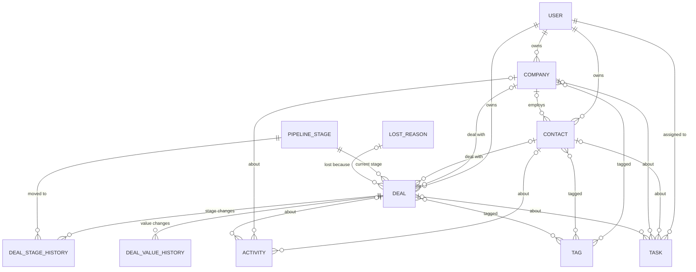

# Domain Map

Every entity in the CRM, its fields, and how the entities connect.
The design choices marked "ADR" are written up properly on Day 4 in `docs/decisions/`.

## Base fields

Every model except `User` and the two history tables gets these from the `core` app (Day 6).

| Field       | Type          | Notes                                                        |
|-------------|---------------|--------------------------------------------------------------|
| id          | BigAutoField  | primary key, added automatically                              |
| created_at  | DateTimeField | auto_now_add=True, set once when the row is created          |
| updated_at  | DateTimeField | auto_now=True, updated on every save                         |
| created_by  | FK → User     | null=True, on_delete=SET_NULL; null for rows made by scripts |
| updated_by  | FK → User     | null=True, on_delete=SET_NULL                                |
| is_active   | BooleanField  | default=True; False = archived (ADR 003)                     |
| archived_at | DateTimeField | null=True, blank=True; null = not archived                   |
| archived_by | FK → User     | null=True, on_delete=SET_NULL                                |

All datetimes are stored in UTC (`USE_TZ = True`); the frontend shows local time.

## Entities

### User  (`accounts` app)

Extends Django's `AbstractUser`. Does **not** use the base fields: it has its own `is_active` (False = can't log in). Users are disabled, never archived.

| Field       | Type                         | Required | Notes                                                  |
|-------------|------------------------------|----------|--------------------------------------------------------|
| email       | EmailField                   | yes      | unique=True; the login field (USERNAME_FIELD)          |
| username    | —                            | —        | removed (set to None); we log in with email            |
| first_name  | CharField(150)               | yes      | in REQUIRED_FIELDS; the UI shows names everywhere      |
| last_name   | CharField(150)               | no       | blank=True                                             |
| role        | CharField(20, choices)       | yes      | admin / manager / rep; default=rep (least privilege)   |
| password    | (from AbstractUser)          | yes      | stored hashed, never as plain text                     |
| is_active   | BooleanField (AbstractUser)  | —        | False = account disabled                               |
| is_staff    | BooleanField (AbstractUser)  | —        | can open the Django admin (developer tool)             |
| date_joined | DateTimeField (AbstractUser) | —        | set automatically                                      |
| last_login  | DateTimeField (AbstractUser) | —        | null until the first login                             |

### Company  (`crm_core` app)

| Field         | Type           | Required | Notes                                                           |
|---------------|----------------|----------|-----------------------------------------------------------------|
| name          | CharField(200) | yes      | **not** unique: two "ABC Traders" can exist; the UI warns later |
| website       | URLField       | no       | blank=True                                                      |
| industry      | CharField(100) | no       | blank=True                                                      |
| phone         | CharField(30)  | no       | text, not a number: keeps "+880" and leading zeros              |
| address       | TextField      | no       | blank=True                                                      |
| owner         | FK → User      | yes      | the responsible rep; on_delete=PROTECT (reassign first)         |
| tags          | M2M → Tag      | no       | blank=True (ADR 002)                                            |
| custom_fields | JSONField      | no       | default=dict (ADR 001)                                          |

### Contact  (`crm_core` app)

| Field         | Type           | Required | Notes                                                                |
|---------------|----------------|----------|----------------------------------------------------------------------|
| first_name    | CharField(100) | yes      |                                                                      |
| last_name     | CharField(100) | no       | blank=True                                                           |
| email         | EmailField     | no       | blank=True, **not** unique: phone-only contacts, shared office inbox |
| phone         | CharField(30)  | no       | blank=True                                                           |
| job_title     | CharField(100) | no       | blank=True                                                           |
| company       | FK → Company   | no       | null=True, blank=True; on_delete=SET_NULL (the person still exists)  |
| owner         | FK → User      | yes      | on_delete=PROTECT                                                    |
| tags          | M2M → Tag      | no       | blank=True                                                           |
| custom_fields | JSONField      | no       | default=dict                                                         |

### Tag  (`crm_core` app)

| Field | Type          | Required | Notes                                      |
|-------|---------------|----------|--------------------------------------------|
| name  | CharField(50) | yes      | unique=True                                |
| color | CharField(7)  | no       | hex like "#22c55e"; default a neutral gray |

### PipelineStage  (`deals` app)

Admin-configurable, not a hardcoded list. Default set (data migration): New → Qualified → Proposal → Won / Lost.

| Field       | Type                      | Required | Notes                                              |
|-------------|---------------------------|----------|----------------------------------------------------|
| name        | CharField(50)             | yes      | unique=True                                        |
| order       | PositiveSmallIntegerField | yes      | unique=True; position of the column on the board   |
| probability | PositiveSmallIntegerField | yes      | 0–100 (CheckConstraint); used for weighted value   |
| kind        | CharField(10, choices)    | yes      | open / won / lost; default=open                    |

### LostReason  (`deals` app)

| Field | Type           | Required | Notes                                         |
|-------|----------------|----------|-----------------------------------------------|
| name  | CharField(100) | yes      | unique=True; e.g. "Price", "Chose competitor" |

### Deal  (`deals` app)

| Field               | Type                 | Required | Notes                                                              |
|---------------------|----------------------|----------|--------------------------------------------------------------------|
| title               | CharField(200)       | yes      |                                                                    |
| value               | DecimalField(14, 2)  | yes      | ≥ 0 (CheckConstraint); never float; changed only by `change_value()` |
| currency            | CharField(3)         | yes      | ISO code like "BDT", "USD"; default from settings                  |
| stage               | FK → PipelineStage   | yes      | on_delete=PROTECT; changed only by `move_stage()`                  |
| company             | FK → Company         | no       | null=True, blank=True; on_delete=SET_NULL                          |
| contact             | FK → Contact         | no       | null=True, blank=True; on_delete=SET_NULL                          |
| owner               | FK → User            | yes      | on_delete=PROTECT                                                  |
| expected_close_date | DateField            | no       | null=True, blank=True; a day, not a moment                         |
| stage_changed_at    | DateTimeField        | yes      | set by `move_stage()`; used for "days in stage"                    |
| closed_at           | DateTimeField        | no       | null=True; set when moved to a won or lost stage                   |
| lost_reason         | FK → LostReason      | no       | null=True; on_delete=PROTECT; **required** when stage.kind = lost  |
| tags                | M2M → Tag            | no       | blank=True                                                         |
| custom_fields       | JSONField            | no       | default=dict                                                       |

### DealStageHistory  (`deals` app)

Append-only: rows are never updated or archived, so no base fields.

| Field      | Type               | Required | Notes                                               |
|------------|--------------------|----------|-----------------------------------------------------|
| deal       | FK → Deal          | yes      | on_delete=CASCADE; related_name="stage_history"     |
| from_stage | FK → PipelineStage | no       | null=True: a new deal has no previous stage         |
| to_stage   | FK → PipelineStage | yes      | on_delete=PROTECT                                   |
| changed_by | FK → User          | no       | null=True, on_delete=SET_NULL                       |
| changed_at | DateTimeField      | yes      | auto_now_add=True                                   |

### DealValueHistory  (`deals` app)

Append-only, same rules as DealStageHistory.

| Field      | Type                | Required | Notes                                          |
|------------|---------------------|----------|------------------------------------------------|
| deal       | FK → Deal           | yes      | on_delete=CASCADE; related_name="value_history" |
| old_value  | DecimalField(14, 2) | no       | null=True: a new deal has no previous value    |
| new_value  | DecimalField(14, 2) | yes      |                                                |
| changed_by | FK → User           | no       | null=True, on_delete=SET_NULL                  |
| changed_at | DateTimeField       | yes      | auto_now_add=True                              |

### Activity  (`activities` app)

Something that already happened. Explicit FKs, not a generic FK (ADR 004).

| Field       | Type                   | Required | Notes                                         |
|-------------|------------------------|----------|-----------------------------------------------|
| type        | CharField(10, choices) | yes      | call / email / meeting / note                 |
| subject     | CharField(200)         | yes      |                                               |
| body        | TextField              | no       | blank=True                                    |
| occurred_at | DateTimeField          | yes      | default=timezone.now; can be in the past      |
| contact     | FK → Contact           | no       | null=True, blank=True; on_delete=CASCADE      |
| company     | FK → Company           | no       | null=True, blank=True; on_delete=CASCADE      |
| deal        | FK → Deal              | no       | null=True, blank=True; on_delete=CASCADE      |

**Rule:** at least one of contact / company / deal must be set (CheckConstraint). The author is `created_by` from the base fields.

### Task  (`activities` app)

Something that still has to be done.

| Field        | Type                   | Required | Notes                                          |
|--------------|------------------------|----------|------------------------------------------------|
| title        | CharField(200)         | yes      |                                                |
| description  | TextField              | no       | blank=True                                     |
| due_at       | DateTimeField          | yes      | drives overdue / today / upcoming              |
| priority     | CharField(10, choices) | yes      | low / medium / high; default=medium            |
| status       | CharField(10, choices) | yes      | open / done; default=open                      |
| assigned_to  | FK → User              | yes      | on_delete=PROTECT                              |
| completed_at | DateTimeField          | no       | null=True; set by `complete_task()`            |
| contact      | FK → Contact           | no       | null=True, blank=True; on_delete=CASCADE       |
| company      | FK → Company           | no       | null=True, blank=True; on_delete=CASCADE       |
| deal         | FK → Deal              | no       | null=True, blank=True; on_delete=CASCADE       |

A task may have no FK at all (e.g. "Prepare the monthly report").

## Relationships

| From → To                        | Type         | on_delete | Why                                                   |
|----------------------------------|--------------|-----------|-------------------------------------------------------|
| Company / Contact / Deal → User (owner) | many-to-one | PROTECT | a customer must never be left without an owner        |
| Task → User (assigned_to)        | many-to-one  | PROTECT   | same reason: reassign before removing a user          |
| Contact → Company                | many-to-one  | SET_NULL  | the person still exists without the company           |
| Deal → Company, Deal → Contact   | many-to-one  | SET_NULL  | keep the deal and its money history                   |
| Deal → PipelineStage             | many-to-one  | PROTECT   | can't delete a stage that still has deals             |
| Deal → LostReason                | many-to-one  | PROTECT   | can't delete a reason that past deals use             |
| DealStageHistory / DealValueHistory → Deal | many-to-one | CASCADE | history means nothing without its deal          |
| Activity / Task → Contact, Company, Deal | many-to-one | CASCADE | notes about a record go with the record          |
| Company / Contact / Deal ↔ Tag   | many-to-many | —         | join tables created by Django                         |

Because records are archived (ADR 003), real deletes are rare: `on_delete` only matters for hard deletes (admin cleanup, GDPR erase later).

## ER diagram

